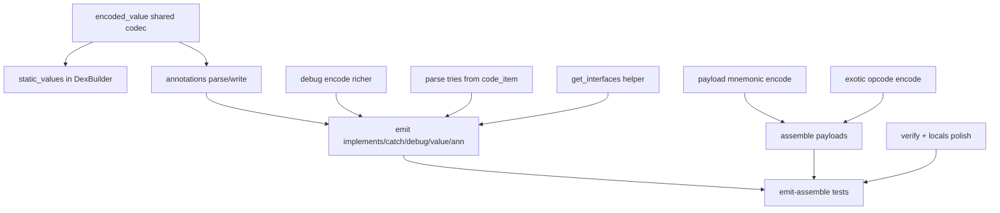

# dex-txt gap closure plan (vs baksmali/smali)

Close the ranked gaps from Apktool/smali comparison. Goal: decode → edit → assemble
preserves semantics for typical apps (annotations, static values, switches, debug, emit
completeness, exotic opcodes) and adds a lightweight verify/locals polish pass.

## Scope

| # | Gap | Deliverable |
|---|-----|-------------|
| 1 | Annotations | Parse/write `annotations_directory` + dex-txt `.annotation`; roundtrip |
| 2 | Static values | `encoded_value` / `encoded_array`; `.value` emit + assemble |
| 3 | Switch/array payloads | Mnemonic `.packed-switch` / `.sparse-switch` / `.array-data` (not only `.hex`) |
| 4 | Debug fidelity | Encode/emit `.line` / `.local` / `.param` / prologue / epilogue |
| 5 | Emit completeness | Emit `.implements`, `.catch`/`.catchall`, debug, `.value`, annotations |
| 6 | Exotic opcodes | Encode `F45cc` / `F4rcc` / related invoke-custom / method-handle forms |
| 7 | Verify + locals | Register-type / branch/label checks; `.locals` ↔ `.registers` |

## Implementation order



### Phase A — Shared binary codecs (`dexparser-rs`)
1. Public `encoded_value` module: decode + encode (byte/short/char/int/long/float/double/string/type/field/method/enum/array/annotation/null/boolean).
2. `static_values`: read/write `encoded_array` at `class_def.static_values_off`.
3. Annotations: parse + write `annotation_item`, `annotation_set_item`, `annotation_set_ref_list`, `annotations_directory_item`; wire `BuiltClass.annotations` / `annotations_off`.
4. `CodeItem::tries()` parse try_item + handlers; `DexFile::get_interfaces`.
5. Richer `build_debug_info` (params, locals, line ops, prologue/epilogue); map list `TYPE_DEBUG_INFO_ITEM`.

### Phase B — dex-txt grammar (`apk-patch-dex`)
1. AST: `DexTxtAnnotation`, visibility; field `.value` typed; payload blocks.
2. Parse/emit `.annotation` … `.end annotation` (class/method/field/param).
3. Emit `.implements`, `.catch`/`.catchall`, debug directives, `.value`.
4. Payload directives:
   ```
   :Lpayload
   .array-data 4
       0x1 0x2
   .end array-data
   ```
   (and packed/sparse-switch equivalents).
5. Assemble: wire annotations, static values, payloads, full debug.

### Phase C — Exotic opcodes (`dex-bytecode`)
1. Implement encode for `F45cc`, `F4rcc`, and remaining call-site / method-handle forms used by invoke-polymorphic / invoke-custom.
2. Extend encode↔decode matrix tests.

### Phase D — Verify + locals polish (`apk-patch-dex`)
1. `.locals N` accepted as `.registers = N + ins_size` (instance) / `N` (static); emit prefers `.registers` with optional `--use-locals` later (default: `.registers` like today; accept both on parse).
2. `verify_method` / `verify_class`: unknown labels, branch range, register index &lt; registers_size, try ranges, payload refs resolve.
3. Optional register-type skeleton: track move/const/invoke-result widths (wide pairs); warn/error on obvious misuse.
4. Hook verify into assemble (fail assemble on hard errors).

### Phase E — Tests & docs
1. Unit: encoded_value roundtrip; annotation directory write/parse; payload encode.
2. Integration: modify_cases + new `parity_gaps.rs` for each gap.
3. Update `DEX-TXT.md`, `PLAN.md`, `PARITY.md`.

## Non-goals (this pass)
- Odex/deodex.
- Smali syntax compatibility.
- Hidden API / compact dex.
- Full ClassPath-based reference subtyping (common-superclass uses `Ljava/lang/Object;` when types differ).

## Success criteria

- [x] TestActivity (and a synthetic annotated class) survive emit → assemble with annotations + static values preserved when present.
- [x] Packed-switch / fill-array-data editable without `.hex`.
- [x] Emit text contains implements/catch/debug when present in DEX.
- [x] Assemble rejects broken labels/registers via verify.
- [x] `.locals` parses correctly.
- [x] Baksmali-style register-type dataflow prover (wide pairs, conflict merges, uninit refs, invoke-result, return kinds, array ops, constructors).

## Status

Items 1–7 implemented. Register-type prover lives in `apk-patch-dex::verify` (`regtype` lattice + CFG dataflow) and runs on every assemble; see `tests/regtype_verify.rs`.
