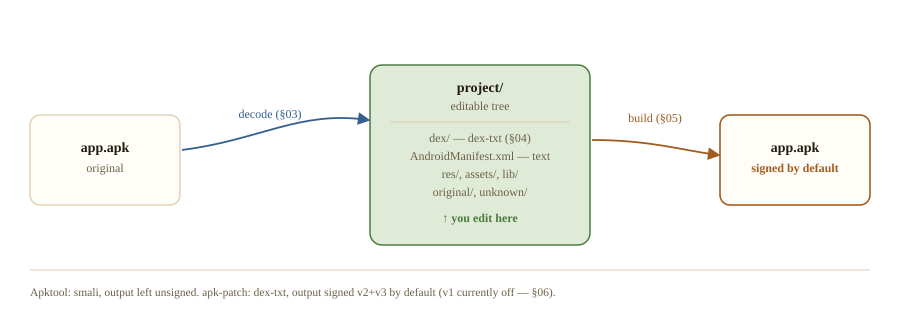
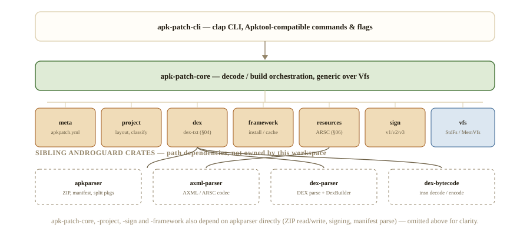
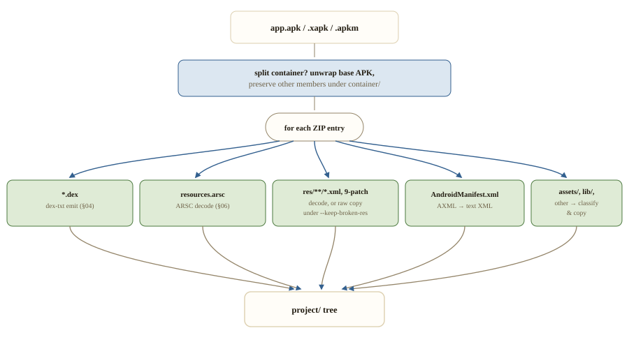
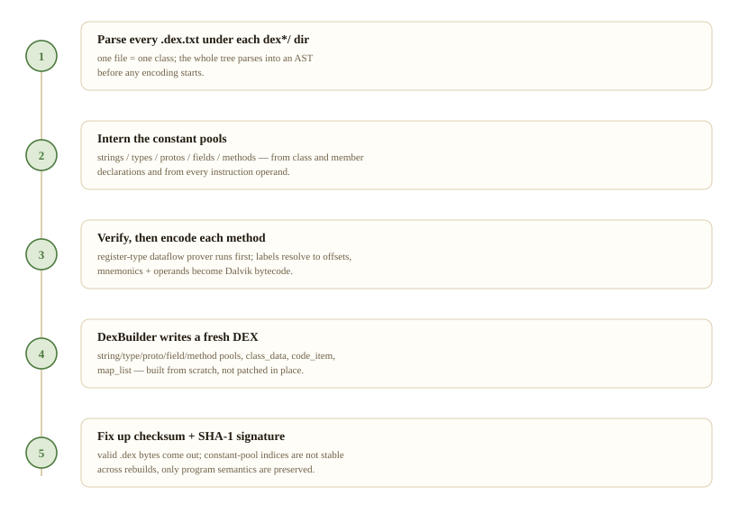
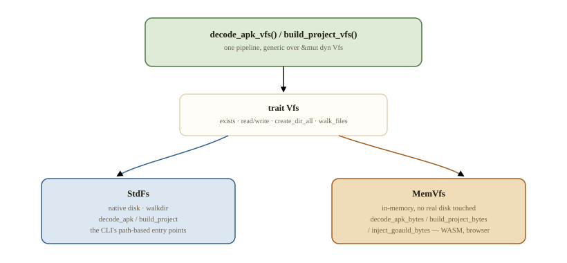
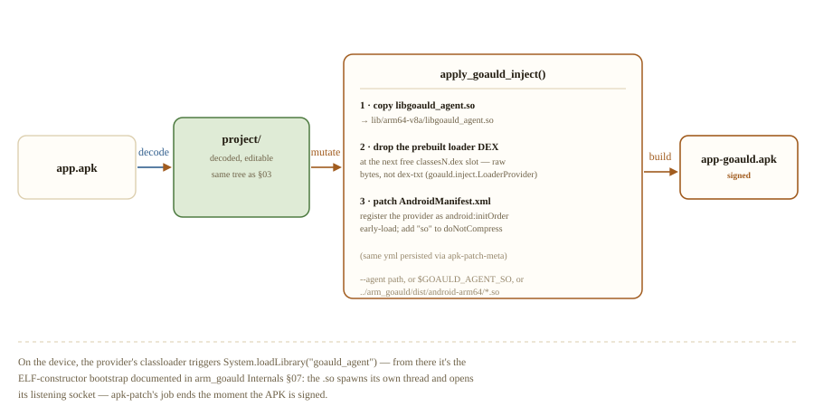

# apk-patch internals

Same shape as Apktool — unpack to an editable tree, edit, repack — but the code inside that tree is text, not smali, and the repacked APK is signed unless you say otherwise.

## Contents

1. [Decode ⇄ build](#decode--build)
2. [Nine crates, four borrowed foundations](#nine-crates-four-borrowed-foundations)
3. [Decode pipeline](#decode-pipeline)
4. [dex-txt: the format instead of smali](#dex-txt-the-format-instead-of-smali)
5. [Build pipeline](#build-pipeline)
6. [Resources & signing](#resources--signing)
7. [One pipeline, two filesystems](#one-pipeline-two-filesystems)
8. [inject-goauld: the bridge to arm_goauld](#inject-goauld-the-bridge-to-arm_goauld)
9. [Command reference](#command-reference)
10. [Parity with Apktool](#parity-with-apktool)

---

## Decode ⇄ build

Everything else in this document is detail underneath one of two verbs. `decode` takes an APK (or an `.xapk` / `.apkm` split container) and produces a directory you can edit by hand: DEX disassembled to [dex-txt](./DEX-TXT.md), the manifest as text XML, resources under `res/`. `build` walks that same directory back into a fresh, signed APK. Nothing in between requires a JVM, `aapt`, or a smali toolchain — both directions are pure Rust, and both share one orchestration core parameterized over a [virtual filesystem](#one-pipeline-two-filesystems) so the same logic runs against real disk or in-memory bytes.



*Fig. 1 — the two commands are symmetric around one editable directory; a second build with no source changes is a near no-op unless `-f` forces it.*

---

## Nine crates, four borrowed foundations

apk-patch is thin: it orchestrates and adds the dex-txt / ARSC-builder / signing pieces Apktool would get from Java tooling, and leans on sibling Androguard crates for everything structural.

`apk-patch-cli` is a clap parser and nothing else. `apk-patch-core` is the only place that knows the full decode/build sequence, and it's written once against a `Vfs` trait (§07) rather than twice for disk and memory. Everything under it is a narrow, single-purpose crate; everything below *that* is a path-dependency on the wider Androguard suite — `apk-patch` doesn't parse a ZIP, a DEX, or an AXML file itself, it composes crates that already do.



*Fig. 2 — dex is the only feature crate that leans on two externals at once — it needs both the structural parser and the instruction encoder.*

---

## Decode pipeline

One pass over the ZIP's file list, dispatched by entry name — no separate "resource pass" or "dex pass".

A split container — `.xapk` or `.apkm` — is unwrapped first: the base APK's bytes are decoded exactly as a normal APK would be, and every other split member (a config-abi split, a language pack) is preserved byte-for-byte under `container/` so `build` can repack the whole set later. From there, `decode_apk_vfs` iterates `apk.get_files()` once and routes each entry by name (**fig. 3**) rather than scanning the archive multiple times.

Two decisions get made in that same pass, per-entry, from CLI flags: whether a `.dex` file gets disassembled to dex-txt at all (`should_disassemble_dex` — only `classes.dex` and `classesN.dex` by default, every root `.dex` under `-a`), and whether `res/` entries get decoded or kept as an exact-case raw ZIP (`original/res-raw.zip`) for a byte-identical rebuild fallback.



*Fig. 3 — `apkpatch.yml` is assembled alongside this loop from the manifest's SDK/version fields and the resource package id, then written once the loop finishes.*

---

## dex-txt: the format instead of smali

Mnemonic-first, assemble-from-scratch, tied directly to `DexFile` / `ClassDef` / `CodeItem` rather than reimplementing a second bytecode language.

One `.dex.txt` file per class, named after its JVM descriptor path (`Lcom/example/MainActivity;` → `com/example/MainActivity.dex.txt`), under a directory keyed to which DEX it came from — `dex/` for `classes.dex`, `dex_classes2/` for `classes2.dex`, `dex_path@to@foo/` for a non-standard `path/to/foo.dex`. Deleting a file deletes the class; adding one adds it — there's no dependency on the original bytes surviving anywhere.

```
.method public onCreate(Landroid/os/Bundle;)V
    .registers 4
    .line 12
    const/4 v0, 0
    invoke-super {p0, p1}, Landroid/app/Activity;->onCreate(Landroid/os/Bundle;)V
    return-void
.end method
```

Branch operands are labels (`goto :L_00000010`), never raw relative offsets — `:L_` plus the 8-digit hex of the original offset on decode, recomputed at assemble time so edits that change instruction count don't require hand-fixing jump targets. Trailing `# hex` is commentary only; a legacy hex-authoritative line format still parses for migration, but assemble always prefers the mnemonic form when both are present.



*Fig. 4 — the same pipeline runs on every `dex*/` directory in parallel during build (§05); a broken label, an out-of-range register, or a mismatched wide-pair fails at step 3, before any bytes are written.*

---

## Build pipeline

Eight steps from a project directory to a signed APK — resource rebuild and dex assembly happen independently, then everything converges into one entry list.


*Fig. 5 — steps 3 and 4 don't depend on each other and run back-to-back rather than truly in parallel today, but neither depends on the other's output — only step 5's collection point needs both finished.*

---

## Resources & signing

### Pure-Rust ARSC builder

Apktool rebuilds resources by shelling out to `aapt2 compile` + `link`. apk-patch's default path is a Rust ARSC encoder that reads `res/values*/`, `public.xml`, and the file-based resources already on disk, and writes `resources.arsc` directly — no external binary, no Android SDK required. `--use-aapt2` switches to the historical path when it's available (native builds only; a VFS/WASM build can never spawn a subprocess, so it always falls back to the Rust builder there regardless of the flag). Framework resolution — package id `1` is "the Android framework", same convention as Apktool — falls back to a minimal embedded `1.apk` when nothing has been installed via `install-framework`, so a fresh checkout can decode framework-dependent apps with zero setup.

### Signing

Unlike Apktool, which leaves rebuilt APKs unsigned, apk-patch signs by default — a debug keystore is used unless `--ks` points at a release one. Three schemes are individually toggleable (`--v1-signing-enabled` / `--v2-…` / `--v3-…`), but the shipped default for `BuildSignConfig` only turns on **v2 and v3**:

**v1 is off by default in the current build** — the code comment in `apk-patch-sign` is explicit about why: "v1 PKCS#7 writer is still incomplete; v2+v3 are verified by apksigner and suffice for Android 7+ installs." An app targeting API < 24 that needs a JAR-signature (v1) APK should pass `--v1-signing-enabled` explicitly and confirm the result with `apksigner verify` — the README's "signed by default (v1 + v2 + v3)" describes the intent, not (yet) the shipped default.

zipalign is not yet wired into the signing step (tracked as a Phase 4 item) — the current known limitation is that a zipalign pass on top of these ZIPs has previously corrupted them, so it stays disabled rather than shipping broken.

---

## One pipeline, two filesystems

The CLI and a hypothetical browser/WASM embedding run *the same* `decode_apk_vfs` / `build_project_vfs` — only what's behind the `Vfs` trait changes.

Every decode/build code path in §03 and §05 is written once against `dyn Vfs` — `exists`, `read` / `write`, `create_dir_all`, `walk_files`, and a handful more. The path-based CLI entry points (`decode_apk`, `build_project`) are a thin wrapper that constructs a `StdFs` and delegates; the bytes-based convenience API (`decode_apk_bytes`, `build_project_bytes`, `inject_goauld_bytes`) constructs a `MemVfs` instead and never touches real disk. Cargo features keep the WASM build lean: `native-fs` (pulls in `StdFs` / walkdir), `parallel` (rayon), `aapt2` (subprocess spawning) and `goauld` (host agent path helpers) are all on by default and meant to be turned off with `--no-default-features` for a browser target — where signing also swaps to an embedded debug key, since `ring`/`rcgen` aren't available on `wasm32`.



*Fig. 6 — nothing in §03 or §05 branches on which Vfs it's running against — a bug fixed for the CLI is fixed for the browser build in the same commit.*

---

## inject-goauld: the bridge to arm_goauld

A one-shot decode → mutate → build that packs `libgoauld_agent.so` into an app and wires up a loader — apk-patch's static counterpart to arm_goauld's runtime `ptrace` injection.

Where arm_goauld gets its agent into a *running* process by seizing it with `ptrace` and forcing a remote `dlopen`, `inject-goauld` gets the same `.so` into an app *before it ever runs*, by editing the APK itself. It composes three primitives this document has already covered: `decode_apk` (§03) to unpack, three targeted file mutations, and `build_project` (§05) to repack and sign.



*Fig. 7 — arm64-v8a only — matches arm_goauld's Android/AArch64 scope; the loader DEX is regenerated from `LoaderProvider.java` via `scripts/regen-goauld-loader.sh` when it needs to change.*

---

## Command reference

| Command | Alias | Purpose |
| --- | --- | --- |
| `decode` | `d` | APK / `.xapk` / `.apkm` → editable project (§03) |
| `build` | `b` | project → signed APK (§05) |
| `inject-goauld` | — | pack `libgoauld_agent.so` + loader, rebuild & sign (§08) |
| `install-framework` | `if` | install a framework APK into the cache (package id resolution, §06) |
| `clean-frameworks` | `cf` | remove cached frameworks |
| `list-frameworks` | `lf` | list cached frameworks |
| `publicize-resources` | `pr` | set `SPEC_PUBLIC` on `resources.arsc` entries |

Full flag lists for `decode` and `build` are in the project `README.md`; the flags that change pipeline behaviour rather than just naming a path are called out inline in §03/§05/§06 above.

---

## Parity with Apktool

Deliberate differences, not gaps — the checklist of matching behaviour lives alongside this doc.

| Feature | Apktool | apk-patch |
| --- | --- | --- |
| Code format | smali | **dex-txt** (§04) |
| Code directories | `smali/` | **`dex/`** |
| Project metadata | `apktool.yml` | **`apkpatch.yml`** (loads legacy `apktool.yml`) |
| Verifier | ClassPath + MethodAnalyzer | **CFG register-type dataflow** (§04); `.registers` default, `.locals` accepted |
| Build signing | unsigned (manual) | **signed by default** — v2+v3 today (§06) |
| Resource rebuild | aapt2 | **pure-Rust ARSC builder** (§06); aapt2 via `--use-aapt2` |

Explicit non-goals: Java/Kotlin decompilation (use JADX), odex/deodex, an aapt1 build path, and smali syntax compatibility — dex-txt is intentionally a different, simpler format rather than a smali clone.

Distilled from `README.md`, `docs/DEX-TXT.md`, and the crate sources in `crates/*/src` at workspace version 0.1.0. Resource decode/encode, split-APK handling, and the register-type verifier are the fastest-moving parts of this codebase.
